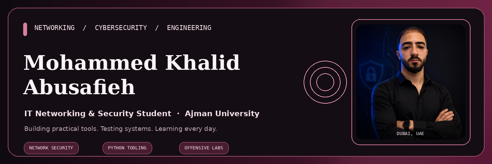
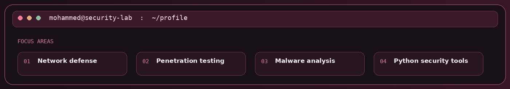
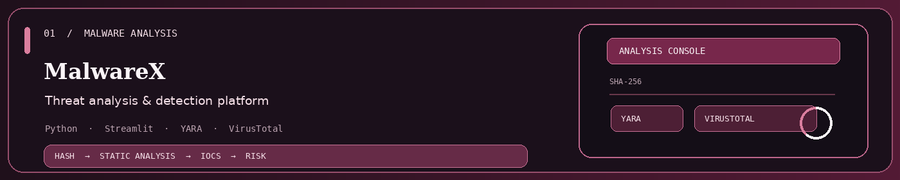
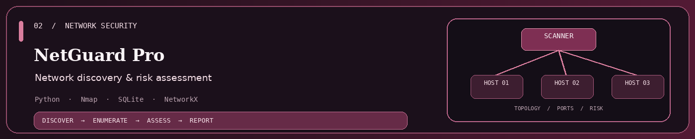
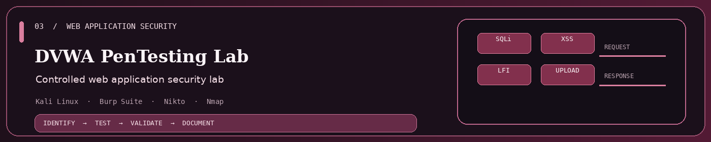
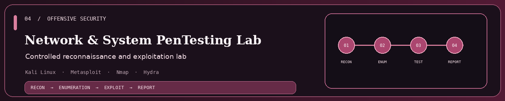
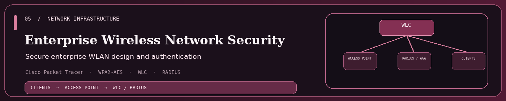
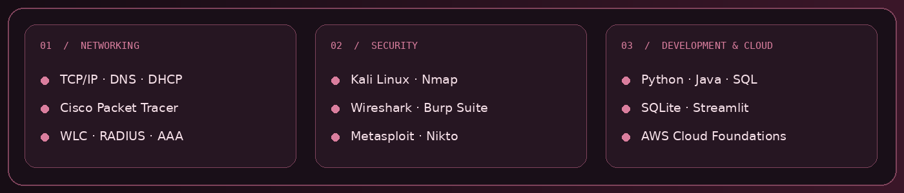
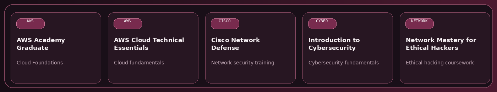

<a href="https://github.com/MohammedAbusafieh">GitHub</a> &nbsp; · &nbsp; <a href="https://ae.linkedin.com/in/mohammed-khalid-abusafieh-06243b284">LinkedIn</a> &nbsp; · &nbsp; <a href="https://mohammedkhalidportfolio.netlify.app/">Portfolio</a> &nbsp; · &nbsp; <a href="mailto:mohammed.abusafieh2004@gmail.com">Email</a>

---

## ABOUT

I am an **Information Technology student specializing in Networking & Security at Ajman University**. I enjoy building practical labs and Python tools across network discovery, malware analysis, and web application security.

- **Education:** BSc Information Technology, Ajman University — expected February 2027
- **Experience:** IT Support Intern, Al Qaro Roads Contracting L.L.C. — June to September 2026
- **Interests:** Network security, infrastructure, vulnerability assessment, and security automation

---

## SELECTED PROJECTS

A Python and Streamlit malware-analysis platform with YARA scanning, VirusTotal lookups, PE analysis, SHA-256 hashing, IOC extraction, and risk assessment.

A network discovery and assessment tool using Nmap for port scanning, service enumeration, topology visualization, risk classification, scan history, and PDF reporting.

A controlled web-security lab exploring SQL injection, XSS, command injection, LFI, file-upload weaknesses, and access-control issues.

A controlled lab covering reconnaissance, enumeration, vulnerability assessment, exploitation, documentation, and remediation.

A Cisco Packet Tracer enterprise WLAN design using WPA2-AES, a wireless LAN controller, RADIUS/AAA authentication, DHCP, and network segmentation.

---

## TECHNICAL TOOLKIT

---

## TRAINING & COURSEWORK

*Training and coursework completions are listed as learning experience, not represented as professional certifications unless the credential explicitly says so.*

---

## GITHUB CONTRIBUTIONS

---

<a href="mailto:mohammed.abusafieh2004@gmail.com">Email</a> &nbsp; · &nbsp; <a href="https://ae.linkedin.com/in/mohammed-khalid-abusafieh-06243b284">LinkedIn</a> &nbsp; · &nbsp; <a href="https://mohammedkhalidportfolio.netlify.app/">Portfolio</a>

