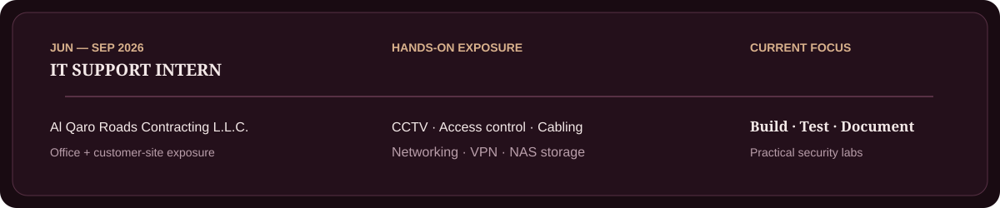
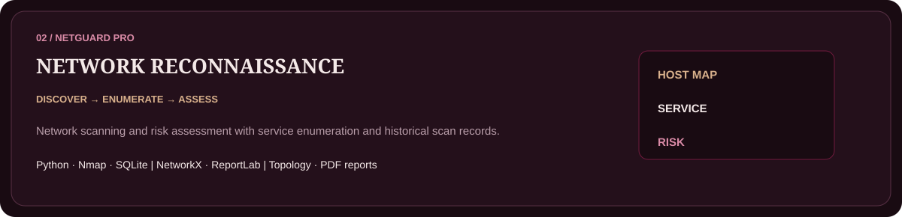
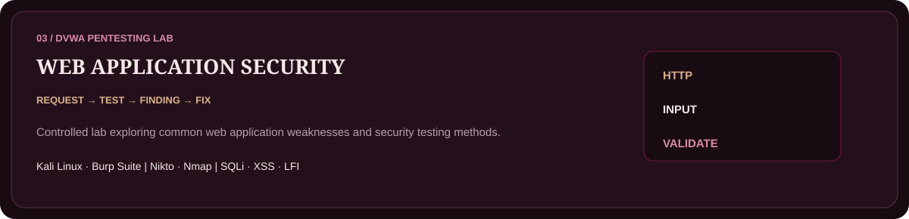
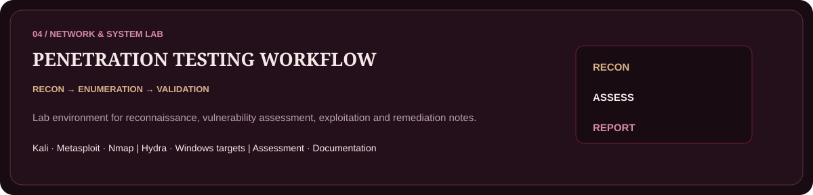
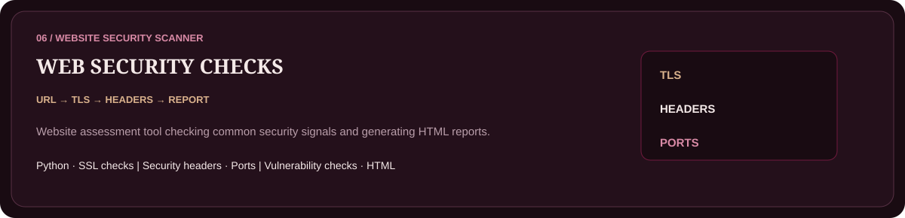
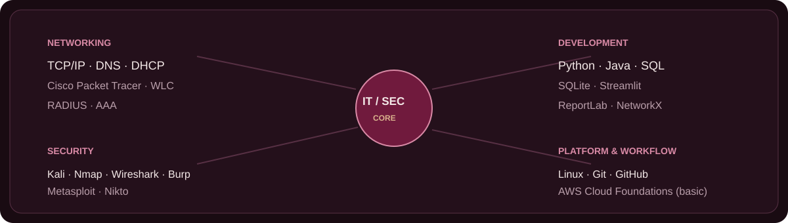
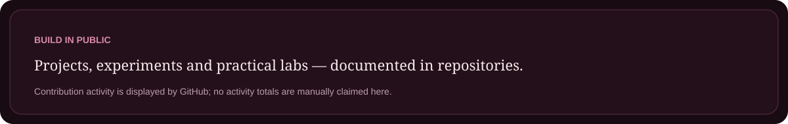

I’m an IT student at **Ajman University**, specializing in **Networking & Security**. I enjoy building practical tools and controlled labs to understand how systems communicate, where they are exposed, and how to assess them responsibly.

**IT Support Intern — Al Qaro Roads Contracting L.L.C.** · *June–September 2026*

Exposure across office and customer-site environments: IT support, CCTV, access control, security-system deployment, structured cabling, networking, VPNs and NAS storage.

[**MalwareX repository →**](https://github.com/MohammedAbusafieh/MalwareX)

[**NetGuard Pro repository →**](https://github.com/MohammedAbusafieh/NetGuard-Pro)

[**DVWA PenTesting Lab repository →**](https://github.com/MohammedAbusafieh/DVWA-PenTesting-Lab)

[**Network & System PenTesting Lab repository →**](https://github.com/MohammedAbusafieh/PenTesting-Lab)

[**Enterprise Wireless Network Security repository →**](https://github.com/MohammedAbusafieh/Enterprise-Wireless-Network-Security)

[**Website Security Scanner repository →**](https://github.com/MohammedAbusafieh/Website-Security-Scanner)

Interested in IT support, networking, infrastructure and practical security opportunities.

<a href="mailto:mohammed.abusafieh2004@gmail.com">mohammed.abusafieh2004@gmail.com</a> · Dubai, UAE

<a href="https://mohammedkhalidportfolio.netlify.app/">Portfolio</a> ·
<a href="https://ae.linkedin.com/in/mohammed-khalid-abusafieh-06243b284">LinkedIn</a> ·
<a href="https://github.com/MohammedAbusafieh">GitHub</a>

