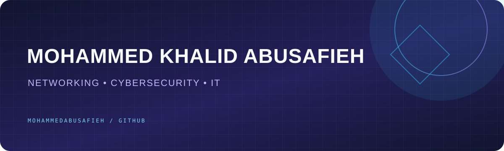
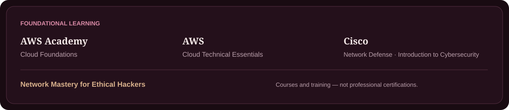
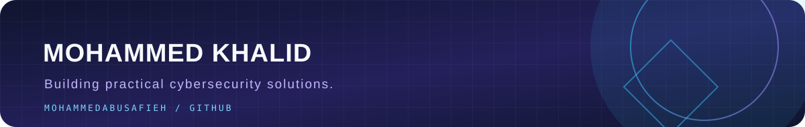

### IT Support Intern — Al Qaro Roads Contracting L.L.C.
**June – September 2026**

- Supported IT operations across office and customer-site environments.
- Gained practical exposure to CCTV, access control, structured cabling and security-system deployment.
- Worked around networking, VPN, NAS storage and general IT support tasks.

### Education
**Ajman University** — Information Technology, Networking & Security  
Expected graduation: February 2027

Interested in opportunities across **IT support, networking and cybersecurity**.

