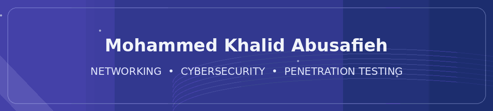
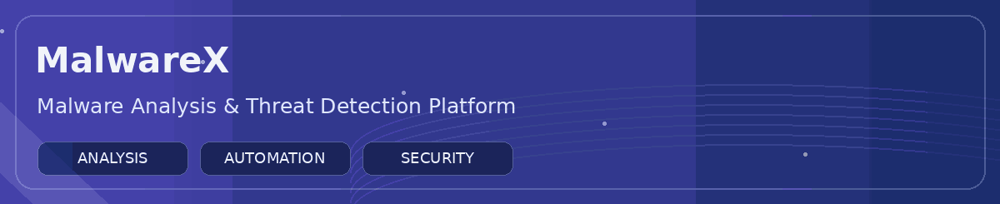
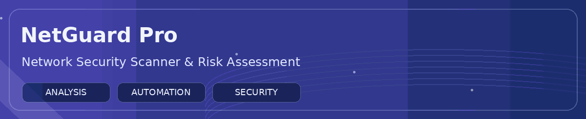
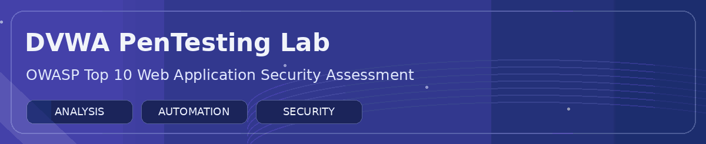
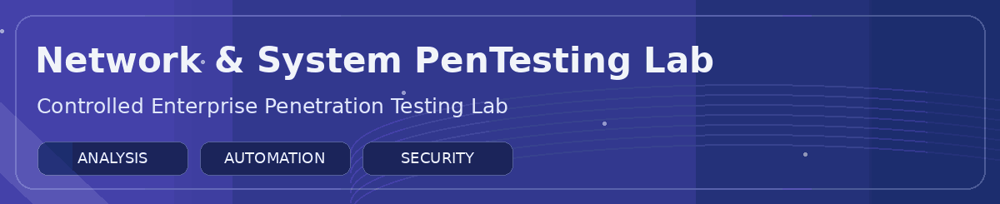
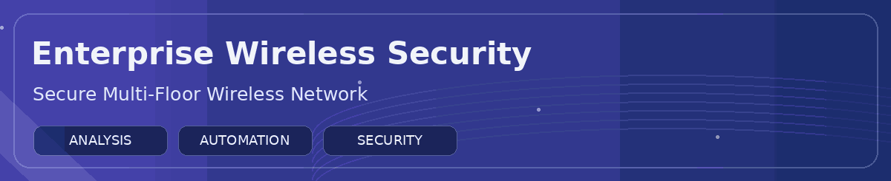
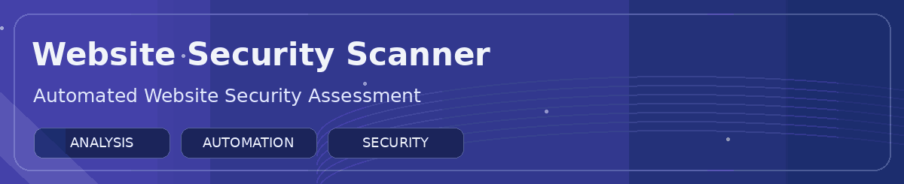
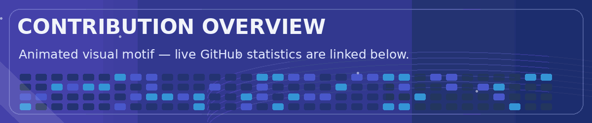
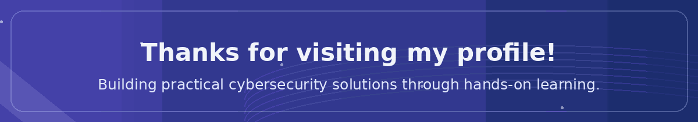

---

Networking & Cybersecurity professional-in-training with hands-on experience in penetration testing, vulnerability assessment, malware analysis, and network security. I enjoy building practical cybersecurity tools, conducting penetration tests, analyzing vulnerabilities and threats, and automating security workflows with Python.

My projects include **MalwareX**, a malware analysis and threat detection platform, and **NetGuard Pro**, a network security scanner and risk assessment tool. My experience also includes web application security, network reconnaissance, incident response, SIEM/log analysis, and enterprise network security. I work with tools such as Kali Linux, Nmap, Metasploit, Burp Suite, Wireshark, Splunk, and Cisco technologies.

### 🎯 Open To
- Security Engineer
- SOC Analyst
- Penetration Tester
- Network Security

---

### Languages

  

### Cybersecurity & Cloud

  

  
  
  
  
  
  
  
  

---

| Project | Description | Tech |
|:--|:--|:--|
| 🦠 **[MalwareX](https://github.com/MohammedAbusafieh/MalwareX)** | Malware Analysis & Threat Detection Platform | Python • Streamlit • YARA • VirusTotal |
| 🌐 **[NetGuard Pro](https://github.com/MohammedAbusafieh/NetGuard-Pro)** | Network Security Scanner & Risk Assessment Platform | Python • Nmap • SQLite |
| 🌍 **[DVWA PenTesting Lab](https://github.com/MohammedAbusafieh/DVWA-PenTesting-Lab)** | OWASP Top 10 Web Application Security Assessment | Kali • Burp Suite • Nikto |
| 🔐 **[Network & System PenTesting Lab](https://github.com/MohammedAbusafieh/PenTesting-Lab)** | Enterprise Penetration Testing Lab | Kali • Metasploit • Hydra |
| 📡 **[Enterprise Wireless Security](https://github.com/MohammedAbusafieh/Enterprise-Wireless-Network-Security)** | Secure Multi-Floor Enterprise Wireless Network | Cisco • WLC • RADIUS |

---

### 🦠 MalwareX

> **Malware Analysis & Threat Detection Platform**

Built to automate malware analysis using static analysis techniques and threat intelligence.

**Key Features**
- Static Malware Analysis
- PE File Analysis
- SHA-256 Hashing
- IOC Extraction
- YARA Scanning
- VirusTotal Integration
- Automated Risk Scoring
- Interactive Dashboard
- Security Reports

**Tech:** `Python` `Streamlit` `YARA` `PEFile` `VirusTotal API` `SQLite`

🔗 **Repository:** [MalwareX](https://github.com/MohammedAbusafieh/MalwareX)

---

### 🌐 NetGuard Pro

> **Network Security Scanner & Risk Assessment Platform**

Designed to discover devices, identify exposed services, and assess network security risks.

**Key Features**
- Host Discovery
- Multi-threaded Port Scanner
- Service Enumeration
- Network Topology
- Risk Classification
- PDF Report Generation
- Historical Scan Tracking

**Tech:** `Python` `Nmap` `SQLite` `ReportLab` `NetworkX` `CustomTkinter`

🔗 **Repository:** [NetGuard Pro](https://github.com/MohammedAbusafieh/NetGuard-Pro)

---

### 🌍 Web Application Penetration Testing Lab (DVWA)

> **OWASP Top 10 Web Application Security Assessment**

Performed a web application penetration test against DVWA following a structured penetration-testing methodology.

**Key Findings**
- SQL Injection
- Cross-Site Scripting (XSS)
- Command Injection
- Local File Inclusion (LFI)
- File Upload Vulnerabilities
- Weak Session Management
- Authorization Bypass
- Open Redirect

**Tools:** `Kali Linux` `DVWA` `Burp Suite` `Nikto` `Nmap`

🔗 **Repository:** [DVWA PenTesting Lab](https://github.com/MohammedAbusafieh/DVWA-PenTesting-Lab)

---

### 🔐 Network & System Penetration Testing Lab

> **Enterprise Penetration Testing Lab**

Hands-on penetration testing against intentionally vulnerable virtual machines to simulate internal security assessments.

**Assessment Workflow**
- Reconnaissance
- Enumeration
- Vulnerability Assessment
- Exploitation
- Documentation
- Remediation Recommendations

**Lab Targets:** `Metasploitable` `Windows XP` `Windows 7`

**Tools:** `Kali Linux` `Metasploit` `Nmap` `Hydra`

🔗 **Repository:** [PenTesting Lab](https://github.com/MohammedAbusafieh/PenTesting-Lab)

---

### 📡 Enterprise Wireless Network Security

> **Cisco Enterprise Wireless Infrastructure**

Designed and configured a secure multi-floor enterprise wireless infrastructure using Cisco Packet Tracer.

**Implemented**
- WPA2-AES Wireless Security
- Wireless LAN Controller (WLC)
- RADIUS / AAA Authentication
- DHCP Services
- IoT Integration
- RFID Authentication
- Enterprise Wireless Segmentation

**Technologies:** `Cisco Packet Tracer` `WLC` `RADIUS` `DHCP` `WPA2-AES`

🔗 **Repository:** [Enterprise Wireless Network Security](https://github.com/MohammedAbusafieh/Enterprise-Wireless-Network-Security)

---

### 🔎 Website Security Scanner

Automated website security analysis covering SSL/TLS, HTTP headers, port scanning, vulnerability checks, and HTML report generation.

🔗 **Repository:** [Website Security Scanner](https://github.com/MohammedAbusafieh/Website-Security-Scanner)

---

- AWS Cloud Foundations
- AWS Technical Essentials
- Cisco Network Defense
- Introduction to Cybersecurity
- Network Mastery for Ethical Hackers

---

  

---

### 🐍 Contribution Snake

  <picture>
    <source media="(prefers-color-scheme: dark)" srcset="https://raw.githubusercontent.com/MohammedAbusafieh/MohammedAbusafieh/output/github-contribution-grid-snake-dark.svg">
    
  </picture>

---

  
  
  
  

### ⭐ Thanks for visiting my profile!

*"Building practical cybersecurity solutions through offensive security, malware analysis, and secure software development."*

