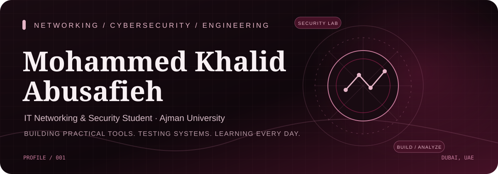
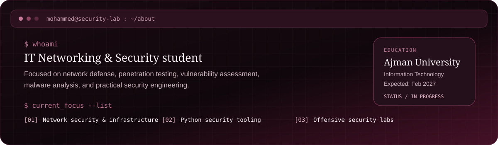
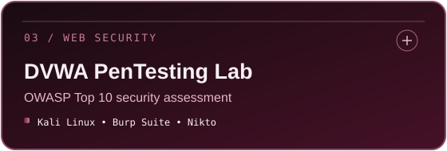
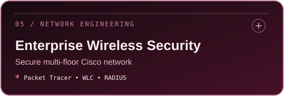
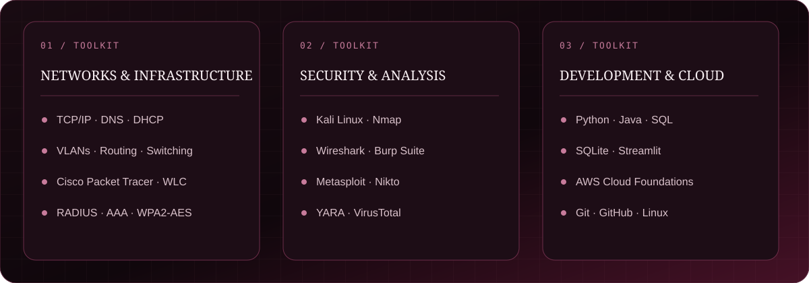
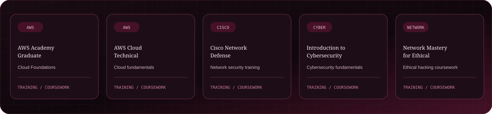
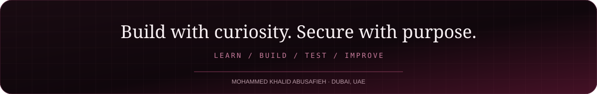

<table width="100%">
<tr>
<td width="72%" valign="middle">

</td>
<td width="28%" align="center" valign="middle">

</td>
</tr>
</table>

 

<a href="https://github.com/MohammedAbusafieh">GITHUB</a>
&nbsp; ◈ &nbsp;
<a href="https://ae.linkedin.com/in/mohammed-khalid-abusafieh-06243b284">LINKEDIN</a>
&nbsp; ◈ &nbsp;
<a href="https://mohammedkhalidportfolio.netlify.app/">PORTFOLIO</a>
&nbsp; ◈ &nbsp;
<a href="mailto:mohammed.abusafieh2004@gmail.com">EMAIL</a>

---

## 01 / ABOUT

I am an **Information Technology student specializing in Networking & Security at Ajman University**, with a practical interest in cybersecurity, network infrastructure, and security tooling.

I enjoy turning concepts into hands-on labs and Python projects — from network discovery to malware analysis and web application testing.

**Education:** BSc Information Technology — Ajman University  
**Expected Graduation:** February 2027  
**Experience:** IT Support Intern — Al Qaro Roads Contracting L.L.C.  
**Internship Period:** June – September 2026

---

## 02 / SELECTED PROJECTS

**MalwareX — Malware Analysis & Threat Detection Platform**

A Python and Streamlit platform for malware analysis, including YARA scanning, VirusTotal lookups, PE analysis, SHA-256 hashing, IOC extraction, and risk assessment.

**Technologies:** Python · Streamlit · YARA · VirusTotal

---

**NetGuard Pro — Network Security Scanner**

A network discovery and security assessment tool using Nmap, with port scanning, service enumeration, topology visualization, risk classification, scan history, and PDF reporting.

**Technologies:** Python · Nmap · SQLite · NetworkX · ReportLab

---

**DVWA PenTesting Lab — Web Application Security**

A controlled web application security lab covering SQL injection, Cross-Site Scripting (XSS), command injection, Local File Inclusion (LFI), file upload weaknesses, and access-control issues.

**Technologies:** Kali Linux · DVWA · Burp Suite · Nikto · Nmap

---

**Network & System PenTesting Lab**

A practical lab covering reconnaissance, enumeration, vulnerability assessment, exploitation, documentation, and remediation in a controlled environment.

**Technologies:** Kali Linux · Metasploit · Nmap · Hydra

---

**Enterprise Wireless Network Security**

A Cisco Packet Tracer enterprise wireless network design featuring WPA2-AES, wireless LAN controller, RADIUS/AAA authentication, DHCP, and secure network segmentation.

**Technologies:** Cisco Packet Tracer · WPA2-AES · WLC · RADIUS · AAA · DHCP

---

## 03 / TECHNICAL TOOLKIT

---

## 04 / TRAINING & COURSEWORK

*These are training and coursework completions, not a claim of professional certification unless a credential explicitly states otherwise.*

---

## 05 / GITHUB CONTRIBUTIONS

The contribution graphic is generated from GitHub activity by the workflow in this repository. It will appear after GitHub Actions runs successfully.

---

## 06 / LET’S CONNECT

  

