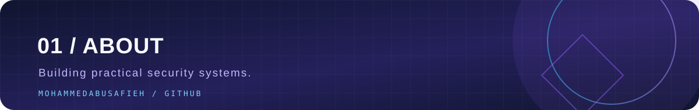
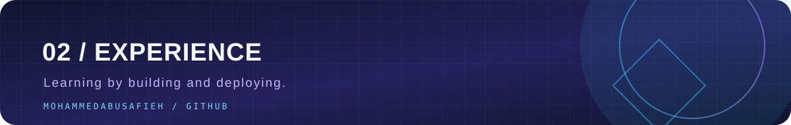
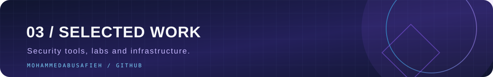
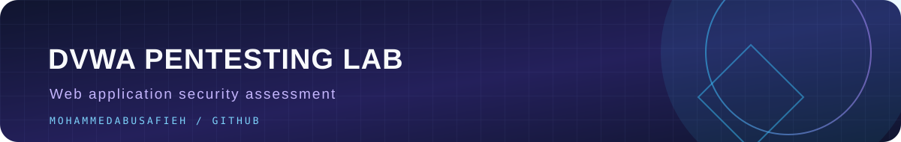
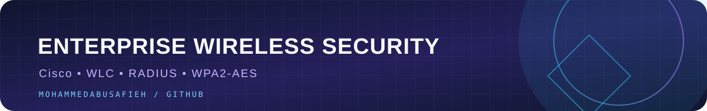
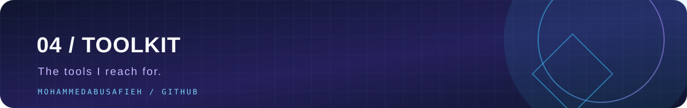
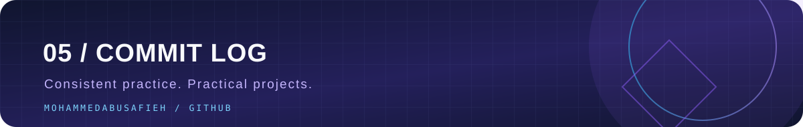
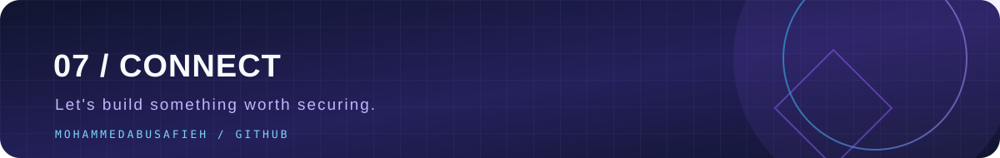

I'm an **IT Networking & Security student at Ajman University**, with expected graduation in **February 2027**. I focus on practical cybersecurity, network defense, vulnerability assessment, malware analysis, and building tools that make security workflows easier.

My hands-on work includes Python security tools, web application penetration-testing labs, network scanning, and enterprise wireless security using Cisco technologies.

### Focus areas
- Network security and infrastructure
- Vulnerability assessment and penetration-testing fundamentals
- Malware analysis and threat intelligence
- Security automation with Python
- IT support, Linux and cloud foundations

**Academic status:** Ajman University — BSc Information Technology, Networking & Security (expected February 2027).

**Practical learning:** Enterprise wireless configuration, network/system testing labs, web application security assessments, malware analysis workflows, and network scanning.

| Project | Overview | Technologies |
|:--|:--|:--|
| [MalwareX](https://github.com/MohammedAbusafieh/MalwareX) | Malware analysis and threat detection platform | Python · Streamlit · YARA · VirusTotal |
| [NetGuard Pro](https://github.com/MohammedAbusafieh/NetGuard-Pro) | Network scanner and risk assessment | Python · Nmap · SQLite |
| [DVWA PenTesting Lab](https://github.com/MohammedAbusafieh/DVWA-PenTesting-Lab) | OWASP-style web application security lab | Kali · Burp Suite · Nikto |
| [Network & System PenTesting Lab](https://github.com/MohammedAbusafieh/PenTesting-Lab) | Hands-on network and system testing | Kali · Metasploit · Nmap · Hydra |
| [Enterprise Wireless Network Security](https://github.com/MohammedAbusafieh/Enterprise-Wireless-Network-Security) | Secure enterprise wireless design | Cisco · WLC · RADIUS · WPA2-AES |
| [Website Security Scanner](https://github.com/MohammedAbusafieh/Website-Security-Scanner) | Automated website security checks | Python · TLS · HTTP security |

**MalwareX** — A malware analysis and threat detection platform with static analysis, PE inspection, SHA-256 hashing, IOC extraction, YARA scanning, VirusTotal integration, risk classification and reporting.

[Open repository](https://github.com/MohammedAbusafieh/MalwareX)

**NetGuard Pro** — Network discovery, multi-threaded port scanning, service enumeration, risk classification, topology visualization and scan reporting.

[Open repository](https://github.com/MohammedAbusafieh/NetGuard-Pro)

**DVWA PenTesting Lab** — A controlled web application security assessment covering common vulnerability classes including SQL injection, XSS, command injection, LFI and file upload issues.

[Open repository](https://github.com/MohammedAbusafieh/DVWA-PenTesting-Lab)

**Network & System PenTesting Lab** — Practical workflow covering reconnaissance, enumeration, vulnerability assessment, exploitation in lab environments, documentation and remediation recommendations.

[Open repository](https://github.com/MohammedAbusafieh/PenTesting-Lab)

**Enterprise Wireless Network Security** — Secure multi-floor wireless infrastructure designed in Cisco Packet Tracer, including WPA2-AES, WLC, RADIUS/AAA, DHCP and segmentation.

[Open repository](https://github.com/MohammedAbusafieh/Enterprise-Wireless-Network-Security)

**Website Security Scanner** — Automated website checks covering SSL/TLS, HTTP security headers, port scanning, vulnerability checks and HTML reporting.

[Open repository](https://github.com/MohammedAbusafieh/Website-Security-Scanner)

### Languages and development

### Security and networking tools

- AWS Academy Cloud Foundations
- AWS Cloud Technical Essentials
- Cisco Network Defense
- Introduction to Cybersecurity
- Network Mastery for Ethical Hackers

### Contribution snake

<a href="https://github.com/MohammedAbusafieh">GitHub</a> ·
<a href="https://ae.linkedin.com/in/mohammed-khalid-abusafieh-06243b284">LinkedIn</a> ·
<a href="mailto:mohammed.abusafieh2004@gmail.com">Email</a> ·
<a href="https://mohammedkhalidportfolio.netlify.app/">Portfolio</a>

